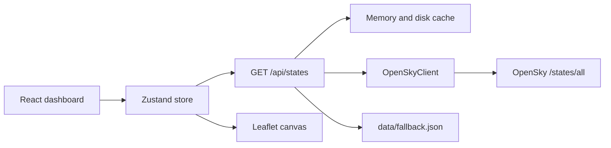

# Airspace

Live air-traffic monitor for a chosen region. Aircraft positions come from the [OpenSky Network REST API](https://openskynetwork.github.io/opensky-api/rest.html). The map keeps moving when that API is late, incomplete, rate-limited, or unreachable.

## Run

```bash
npm install
npm run dev
```

Open [http://localhost:3000](http://localhost:3000). Tests:

```bash
npm test
```

Optional credentials live in `.env.local` (see `.env.example`). Leave them empty for anonymous access. The browser never sees them.

```
OPENSKY_CLIENT_ID=
OPENSKY_CLIENT_SECRET=
```

Anonymous callers get 400 credits per day, a 10 second state resolution, and no historical `time` queries. Authenticated callers use the OAuth2 client-credentials flow documented by OpenSky. Tokens stay on the server and refresh before they expire.

## Architecture



- **Next.js App Router** serves the UI and a Node route that proxies OpenSky. Direct browser calls fail the OpenSky CORS policy (`Access-Control-Allow-Origin` is limited to their own site).
- **`OpenSkyClient`** (`src/lib/opensky/client.ts`) is the API client. It builds `/states/all` queries, exchanges client credentials for a bearer token, refreshes that token, and classifies 429s, HTTP errors, network failures, and incomplete payloads. The route still owns the 15-second cache, in-flight dedupe, and the recorded London fallback. Call `new OpenSkyClient()` or `openSkyClientFromEnv()` from server code. Do not import it into the browser.
- **Zustand** holds the tracked aircraft, filters, alerts, session snapshots, and feed health. Settings and the last picture are persisted in `localStorage`.
- **Leaflet** draws the base map. Aircraft, trails, and the region box are painted on one canvas each frame, so a few thousand tracks do not create a DOM node each.

`/api/states` accepts `lamin`, `lomin`, `lamax`, and `lomax`. Regions larger than 400 square degrees are rejected. Credit cost follows OpenSky’s published schedule: 1, 2, 3, or 4 credits as the box grows through 25, 100, and 400 sq°.

## State management

Each aircraft is keyed by ICAO24. A successful snapshot is merged into that dictionary:

- A new address emits **entered**.
- An address missing from a newer snapshot **coasts** on its last vector, then becomes **departed** after 90 seconds and is dropped after 180 seconds.
- A report that omits latitude or longitude keeps the previous fix and is marked as a held position.
- Each accepted fix is appended to a short observation trail. Jumps over 80 km break the line instead of drawing a false path.

The same snapshot is not merged twice. Re-applying an unchanged `upstreamTime` would refresh “last seen” and hide aircraft that had already gone quiet.

Replay reads a ring of up to 120 snapshots captured this session. The scrubber interpolates latitude, longitude, altitude, speed, and track between adjacent frames. Upstream polling pauses during replay and offline mode.

## Stale data, failures, and request limits

OpenSky’s anonymous feed only changes every 10 seconds, and each bounding-box call spends credits. The dashboard therefore does not poll the upstream API on every animation frame.

| Situation | What the app does |
| --- | --- |
| Poll inside 15 seconds | The route returns the in-memory snapshot and does not call OpenSky. |
| Identical snapshot | The client skips the merge and only refreshes the age display. |
| HTTP 429 | The route reads `X-Rate-Limit-Retry-After-Seconds`, serves the last good snapshot, and the client waits at least that long. |
| Timeout, HTTP error, or bad JSON | The last snapshot for that region is served from memory or the temp-dir disk cache. |
| No snapshot, and the region overlaps the recorded London box | `data/fallback.json` (a real OpenSky response) is served and labeled as recorded. Other regions are not filled with London traffic. |
| Browser offline, or the user clicks **Go offline** | Polling stops. The last `localStorage` picture stays on the map and dead-reckons until the vector is too old. |
| Position older than 75 seconds | The aircraft is drawn as an outdated fix. |
| Missing speed, track, or a parked aircraft | The icon stays on the reported point. No invented motion. |
| Estimate older than 3 minutes | The projected point freezes and the detail panel says so. |

Between polls, airborne aircraft with a ground speed and true track are projected forward (and vertically, when a vertical rate exists). That estimate is labeled separately from the last reported coordinate. Alerts evaluate the estimated position, so a watch box can still trip between updates.

The status bar shows feed state, snapshot age, OpenSky credits remaining, and roughly how long the current refresh interval can run before the daily budget is gone. The default interval is 30 seconds. The tab pauses requests while it is hidden.

Rendering stays cheap when a region is busy: one canvas, viewport culling, and a windowed traffic list. Trails for every aircraft are drawn only when the visible set is small; otherwise only the selected trail is drawn. Clustering is intentionally not used — an air-traffic picture needs the individual tracks.

## Using the dashboard

- Pick a preset region, type bounds, or choose **Draw on map** and drag a rectangle.
- Filter by callsign, ICAO24, squawk, country, airborne or ground, altitude, and speed.
- Select an aircraft for the reported state and the session trail. **Follow** keeps it centered until you drag the map.
- Enable alerts for emergency squawks (7500, 7600, 7700), speed, altitude, or “inside this region.”
- After two live snapshots, **Replay** scrubs the picture collected in this session.

## Deploy

Any Node host that can run `next build` and `next start` is enough. On serverless, the in-memory cache is per instance; the browser copy and `data/fallback.json` still cover a cold start. Put credentials in the host’s environment, not in the client bundle.

## Requirements & Deliverables Matrix

| # | Requirement | Implementation Location | Description |
|---|---|---|---|
| **01** | Retrieve live aircraft data | [`src/server/opensky.ts`](file:///c:/Users/manas/ccf/src/server/opensky.ts), [`src/lib/opensky/client.ts`](file:///c:/Users/manas/ccf/src/lib/opensky/client.ts) | Server-side proxy fetches `/states/all` with bounding box, handles anonymous credits & OAuth2 tokens, no browser CORS failure or credential leaks. |
| **02** | Interactive map | [`src/components/MapView.tsx`](file:///c:/Users/manas/ccf/src/components/MapView.tsx) | Leaflet map with HTML5 Canvas overlay, 60fps frame loop, high-DPI scaling, rotated chevrons, squares on ground, altitude/alert colors. |
| **03** | Aircraft telemetry display | [`src/components/TrafficColumn.tsx`](file:///c:/Users/manas/ccf/src/components/TrafficColumn.tsx), [`src/lib/format.ts`](file:///c:/Users/manas/ccf/src/lib/format.ts) | Altitude (baro/geo, flight level), speed, heading, vertical rate, squawk, country, coordinates, fix timestamps, SVG altitude sparkline. |
| **04** | Periodic updates without waste | [`src/lib/poller.ts`](file:///c:/Users/manas/ccf/src/lib/poller.ts), [`src/components/StatusBar.tsx`](file:///c:/Users/manas/ccf/src/components/StatusBar.tsx) | Configurable polling (20s/30s/60s/2m), 15s server-side rate throttle, in-flight Promise dedupe, tab visibility auto-pause, manual sync. |
| **05** | Region selection & filtering | [`src/lib/regions.ts`](file:///c:/Users/manas/ccf/src/lib/regions.ts), [`src/components/Controls.tsx`](file:///c:/Users/manas/ccf/src/components/Controls.tsx) | 10 worldwide presets, custom bounds inputs, interactive "Draw on map" box tool, filters for callsign/ICAO, phase, country, alt/speed ranges, squawk. |
| **06** | State maintenance (enter/leave) | [`src/lib/track.ts`](file:///c:/Users/manas/ccf/src/lib/track.ts), [`src/store/airspace.ts`](file:///c:/Users/manas/ccf/src/store/airspace.ts) | Lifecycle tracking (`entered`, `active`, `coasting` for 90s, `departed`, `dropped` after 180s), retains coordinates when omitted in fix, event log. |
| **07** | Handle API failures & limits | [`src/server/opensky.ts`](file:///c:/Users/manas/ccf/src/server/opensky.ts), [`data/fallback.json`](file:///c:/Users/manas/ccf/data/fallback.json) | 429 backoff header parsing, memory & disk cache (`airspace-cache.json`), recorded London fallback, visual dashed circles for stale vectors (>75s). |
| **08** | Recent movement observations | [`src/lib/track.ts`](file:///c:/Users/manas/ccf/src/lib/track.ts), [`src/components/TrafficColumn.tsx`](file:///c:/Users/manas/ccf/src/components/TrafficColumn.tsx) | Breadcrumb observation history, >80 km jump detection, canvas trajectory trails, observation coordinate history table. |
| **B1** | Position dead reckoning | [`src/lib/predict.ts`](file:///c:/Users/manas/ccf/src/lib/predict.ts), [`src/lib/geo.ts`](file:///c:/Users/manas/ccf/src/lib/geo.ts) | Great Circle navigation projecting position along heading using ground speed & vertical rate between updates; 3-minute extrapolation freeze. |
| **B2** | Historical replay scrubber | [`src/components/ReplayBar.tsx`](file:///c:/Users/manas/ccf/src/components/ReplayBar.tsx), [`src/lib/scene.ts`](file:///c:/Users/manas/ccf/src/lib/scene.ts) | 120-snapshot session buffer with scrub slider, play/pause, 1x/4x/12x speed, linear position and angle interpolation between frames. |
| **B3** | Rendering optimization | [`src/components/MapView.tsx`](file:///c:/Users/manas/ccf/src/components/MapView.tsx) | Single HTML5 Canvas layer instead of DOM elements, viewport culling, virtualized traffic list. |
| **B4** | Offline mode & caching | [`src/components/StatusBar.tsx`](file:///c:/Users/manas/ccf/src/components/StatusBar.tsx), [`src/store/airspace.ts`](file:///c:/Users/manas/ccf/src/store/airspace.ts) | "Go offline" toggle, localStorage state rehydration, recorded London snapshot fallback. |
| **B5** | Configurable alert system | [`src/lib/alerts.ts`](file:///c:/Users/manas/ccf/src/lib/alerts.ts), [`src/components/Dashboard.tsx`](file:///c:/Users/manas/ccf/src/components/Dashboard.tsx) | Squawk emergency alerts (7500, 7600, 7700), high speed, altitude thresholds, custom watch boxes, flashing emergency banner with "Focus Track". |
| **B6** | Test suite | [`src/lib/logic.test.ts`](file:///c:/Users/manas/ccf/src/lib/logic.test.ts), [`src/lib/opensky/client.test.ts`](file:///c:/Users/manas/ccf/src/lib/opensky/client.test.ts) | 20 unit tests across 8 suites covering parsing, dead reckoning, track lifecycle, alerts, geo math, filtering, and API client error handling. |
